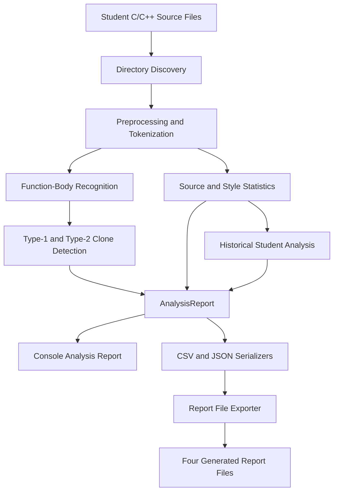

# CloneScope

**An Explainable Code Clone Tagging and Stylometric Analysis Tool**

**Student:** Raian Huq (BSSE1708)
**Course:** Software Project Lab (SPL-01)
**Institute:** Institute of Information Technology (IIT), University of Dhaka
**Supervisor:** Dr. Kazi Muheymin-Us-Sakib
**Language:** C++17
**Development environment:** Windows, VS Code, PowerShell, Git and GitHub

## Project Overview

CloneScope is a rule-based C++17 application being developed to identify and explain code-similarity candidates in student programming submissions. It currently analyzes supported C/C++ function bodies and reports:

- **Type-1 body-level candidates:** identical token types and lexemes after supported comment removal and whitespace-insensitive tokenization.
- **Type-2-only body-level candidates:** the same supported token structure with consistent one-to-one identifier renaming and otherwise identical token lexemes.

Reports contain source-file paths, relevant line ranges, the matching rule and an explicit human-review warning.

The current statistical layer also reports source-line and token counts, unique
identifier naming conventions, commenting rates, and deviations from a student's
earlier assignments. A combined final report presents the findings together
without treating a style change as proof of copying.

**CloneScope does not determine plagiarism.** Similarity findings are evidence for instructors to examine in context; they are not accusations or automatic judgments. The project does not use machine-learning training.

The current implementation is an explainable **prototype**, not a full C/C++ parser or comprehensive clone-detection engine.

## Approved Project Scope

The supervisor-approved direction includes:

- Type-1, Type-2 and Type-3 code clone detection.
- Restricted Type-4 clone candidate screening.
- Stylometric analysis of programming habits.
- Student-wise and pairwise statistical analysis.
- Explainable source-location evidence and human-review reports.
- CSV/JSON data export.

**Only the features identified as implemented below are currently available.** Type-1 and restricted Type-2-only body-level candidate detection, statistical stylometry, historical comparisons, consolidated console reporting, and CSV/JSON report export are implemented and tested. Type-3 and restricted Type-4 detection remain future work after the midterm. CloneScope is an explainable prototype, not an automatic plagiarism detector or authorship classifier.

## Current Development Status

| Item                                                              | Status as of 8 November 2026                                                   |
| ----------------------------------------------------------------- | ------------------------------------------------------------------------------ |
| Application, preprocessing, tokenization, function-body detection | Implemented and tested                                                         |
| Type-1 and restricted Type-2-only body candidate detection        | Implemented and tested                                                         |
| Source-line and function statistics                               | Implemented and tested                                                         |
| Identifier-style and commenting-style statistics                  | Implemented and tested                                                         |
| Student-wise naming and commenting history                        | Implemented with evidence thresholds and numerical assignment ordering         |
| Detailed body-pair locations and combined console analysis report | Implemented and integration-tested                                             |
| Controlled classroom dataset                                      | 22 synthetic students, 3 assignments each, 66 C++17 files                      |
| CSV report serialization                                          | Implemented and tested                                                         |
| JSON report serialization                                         | Implemented and tested                                                         |
| Physical CSV/JSON report generation                               | Implemented and integration-tested; four files saved in a unique run directory |
| Complete smoke-test regression                                    | 28 of 28 test executables passed                                               |
| Current feature branch                                            | `feat/csv-json-report-export`, pushed; PR review and merge pending             |
| Type-3 and restricted Type-4 detection                            | Future work after the midterm                                                  |

**Historical Phase 3 commits (retained for development history):**

- `e4b156d` — `feat: implement Type-2 identifier mapping and region matching`
- `9a658e9` — `feat: integrate Type-2 reporting and recursive source discovery`
- `2c6e033` — `test: add Type-2 reporting and invalid-region regression checks`

The older Type-2 implementation details later in this README are preserved as a historical Phase 3 technical explanation. The status table above describes the newer pre-midterm feature milestone. A feature branch is not considered merged until its Pull Request has been reviewed and merged.

## CloneScope Midterm Demonstration and Project Architecture

This section provides a practical overview of CloneScope's implemented
pre-midterm functionality, architecture, repository organization,
execution workflow, and verified results.

The detailed technical explanations and chronological development history
in the following sections are preserved.

### 1. What CloneScope Does

CloneScope is an explainable C++17 code clone tagging and statistical
stylometric analysis tool designed for student programming submissions.

The application analyzes supported C/C++ source files and identifies
code-similarity candidates that may deserve further human inspection.

Its current capabilities include:

- Type-1 function-body clone candidate detection.
- Restricted Type-2-only function-body clone candidate detection.
- Source code preprocessing and tokenization.
- Supported function-body recognition.
- Source-line, token, and function-body statistics.
- Identifier naming-style analysis.
- Commenting-style analysis.
- Historical student programming-style comparisons.
- Student-wise human-review indicators.
- Detailed candidate source-file paths and line ranges.
- Combined terminal analysis reports.
- CSV and JSON report generation.

CloneScope does not automatically determine plagiarism.

Similarity and programming-style deviations are indicators for human
review, not proof of academic misconduct.

Type-3 and restricted Type-4 clone detection remain future work
after the midterm.

### 2. System Architecture

The application follows a modular analysis and reporting pipeline.



The architecture separates three major responsibilities:

1. **Analysis:** Read source code, identify supported function bodies,
   detect clone candidates, and calculate statistical evidence.

2. **Reporting:** Collect completed findings into an `AnalysisReport`
   and present them as understandable results.

3. **Exporting:** Serialize the existing findings into CSV and JSON
   files without repeating clone detection or stylometric analysis.

This separation makes the project easier to test, maintain, and extend.

### 3. Project Repository Structure

The following diagram groups related components for readability.
Files represented as `module.*` generally have corresponding
`.hpp` and `.cpp` files.

```text
SPL_01_BSSE1708/
|
|-- src/
|   |
|   |-- main.cpp
|   |-- application.hpp
|   |-- application.cpp
|   |
|   |-- preprocessor.*
|   |-- tokenizer.*
|   |-- code_region.*
|   |-- function_region.*
|   |
|   |-- type1_clone.*
|   |-- type1_report.*
|   |-- type2_clone.*
|   |-- type2_report.*
|   |
|   |-- source_statistics.*
|   |-- identifier_style.*
|   |-- identifier_history.*
|   |-- comment_style.*
|   |-- comment_history.*
|   |-- assignment_order.*
|   |
|   |-- clone_summary.*
|   |-- analysis_report.*
|   |
|   |-- csv_export.*
|   |-- json_export.*
|   |-- report_file_export.*
|
|-- tests/
|   |
|   |-- fixtures/
|   |   |-- cohort22/
|   |   `-- other controlled test fixtures/
|   |
|   |-- analysis_report_smoke.cpp
|   |-- csv_export_smoke.cpp
|   |-- csv_overview_smoke.cpp
|   |-- csv_candidates_smoke.cpp
|   |-- csv_student_findings_smoke.cpp
|   |-- json_string_smoke.cpp
|   |-- json_summary_smoke.cpp
|   |-- json_candidates_smoke.cpp
|   |-- json_student_findings_smoke.cpp
|   |-- json_report_structure_smoke.cpp
|   |-- review_indicators_smoke.cpp
|   |-- report_file_export_smoke.cpp
|   `-- other Phase 1-4 smoke tests/
|
|-- docs/
|   `-- learning-notes/
|       |-- Phase 1-4 learning manuals
|       `-- Phase 5 technical learning manual
|
|-- samples/
|-- Document/
|
|-- .gitignore
|-- README.md
|
`-- clonescope_reports/   (generated locally; Git-ignored)
```

The `src` directory contains the application implementation.

The `tests` directory contains focused regression tests and
controlled source-code datasets.

The `docs/learning-notes` directory preserves the technical
learning manuals created throughout development.

The `clonescope_reports` directory is generated when a directory
analysis completes successfully. It is excluded from Git commits.

### 4. Main Source Modules and Responsibilities

| Component              | Responsibility                                           |
| ---------------------- | -------------------------------------------------------- |
| `main.cpp`             | Application entry point                                  |
| `application.cpp`      | User interaction and overall analysis coordination       |
| `preprocessor.*`       | Supported source-code comment removal                    |
| `tokenizer.*`          | Lexical token construction and source positions          |
| `code_region.*`        | Matched code-block region identification                 |
| `function_region.*`    | Supported function-body recognition                      |
| `type1_clone.*`        | Type-1 body-level candidate matching                     |
| `type1_report.*`       | Explainable Type-1 reporting                             |
| `type2_clone.*`        | Consistent identifier-renaming candidate matching        |
| `type2_report.*`       | Explainable Type-2-only reporting                        |
| `source_statistics.*`  | Source-line, blank-line, token, and function statistics  |
| `identifier_style.*`   | Identifier naming-convention classification              |
| `identifier_history.*` | Historical naming-style comparison                       |
| `comment_style.*`      | Source-code commenting statistics                        |
| `comment_history.*`    | Historical commenting-style comparison                   |
| `assignment_order.*`   | Numeric assignment ordering and validation               |
| `clone_summary.*`      | Candidate source paths, classifications, and line ranges |
| `analysis_report.*`    | Combined analysis data and human-review reporting        |
| `csv_export.*`         | CSV serialization of analysis findings                   |
| `json_export.*`        | JSON serialization of analysis findings                  |
| `report_file_export.*` | Physical report-file generation and directory management |

### 5. Important Report Export Functions

Phase 5 introduced reusable serialization and file-export functions.

| Function                           | Purpose                                                         |
| ---------------------------------- | --------------------------------------------------------------- |
| `escapeCsvField()`                 | Correctly quotes supported special characters in CSV fields     |
| `writeAnalysisOverviewCsv()`       | Writes the overall dataset statistics                           |
| `writeCloneCandidatesCsv()`        | Writes detailed clone candidate records                         |
| `writeStudentFindingsCsv()`        | Writes student-wise stylometric findings                        |
| `writeJsonString()`                | Escapes strings for valid JSON output                           |
| `writeJsonSummary()`               | Writes the structured dataset and statistical summary           |
| `writeJsonCloneCandidates()`       | Writes the JSON clone candidate array                           |
| `writeJsonStudentFindings()`       | Writes student-wise JSON finding records                        |
| `writeJsonHumanReviewIndicators()` | Writes students and their review reasons                        |
| `writeAnalysisReportJson()`        | Combines all JSON report sections                               |
| `collectHumanReviewIndicators()`   | Collects distinct student-wise review reasons                   |
| `exportAnalysisReportFiles()`      | Creates a unique run directory and writes all four report files |

These functions operate on the results already computed by the
application. They do not independently rerun clone detection.

### 6. Build and Run CloneScope

CloneScope is implemented using C++17.

The following commands are intended for Windows PowerShell,
executed from the repository root.

#### Compile the application

```powershell
$sourceFiles = Get-ChildItem .\src -Filter *.cpp | Select-Object -ExpandProperty FullName

g++ -std=c++17 -Wall -Wextra -pedantic $sourceFiles -o .\clonescope.exe

$LASTEXITCODE
```

An exit code of `0` indicates successful compilation.

#### Analyze the controlled 22-student dataset

```powershell
@(".\tests\fixtures\cohort22", "y") | .\clonescope.exe > .\clonescope_integration.log

$LASTEXITCODE
```

The application analyzes the controlled student submissions and
generates a combined report.

#### Inspect the final execution output

```powershell
Get-Content .\clonescope_integration.log -Tail 25
```

After successful directory analysis, the program displays a report
export confirmation.

### 7. Generated CSV and JSON Reports

CloneScope automatically creates a new directory for every
successful report export.

Example:

```text
clonescope_reports/
|
|-- run_1/
|   |-- analysis_overview.csv
|   |-- clone_candidates.csv
|   |-- student_findings.csv
|   `-- analysis_report.json
|
|-- run_2/
|   |-- analysis_overview.csv
|   |-- clone_candidates.csv
|   |-- student_findings.csv
|   `-- analysis_report.json
|
`-- ...
```

Existing run directories are preserved.

The export module searches for the next available directory name,
up to its configured limit.

#### Report file descriptions

| File                    | Contents                                                              |
| ----------------------- | --------------------------------------------------------------------- |
| `analysis_overview.csv` | Dataset, source-code, and clone-detection statistics                  |
| `clone_candidates.csv`  | Candidate type, participating students, source paths, and line ranges |
| `student_findings.csv`  | Student naming and commenting-style evaluation results                |
| `analysis_report.json`  | Complete structured report, including human-review indicators         |

### 8. Example CSV Output

The following values come from the controlled 22-student
integration dataset.

**analysis_overview.csv**

```csv
metric,value
student_folders,22
source_files,66
compared_file_pairs,2145
total_source_lines,6973
blank_source_lines,242
total_tokens,30995
recognized_function_bodies,242
type1_candidate_pairs,10
type2_only_candidate_pairs,10
```

These values describe the analyzed dataset and reported
candidate counts.

They are not measurements of plagiarism-detection accuracy.

### 9. Example JSON Output

The JSON report organizes findings into nested objects and arrays.

The following is an abbreviated illustration of verified
cohort statistics; the complete generated report contains
additional fields and arrays.

```json
{
  "summary": {
    "dataset_overview": {
      "student_folders": 22,
      "source_files": 66,
      "compared_file_pairs": 2145
    },
    "clone_detection": {
      "type1_candidate_pairs": 10,
      "type2_only_candidate_pairs": 10,
      "total_candidate_pairs": 20
    }
  },
  "human_review_indicators": {
    "student_count": 12
  }
}
```

The complete JSON report also includes:

- Tool name and format version.
- Source-code statistics.
- Clone candidate classifications.
- Both source locations for each candidate.
- Student naming and commenting-style findings.
- Student-wise human-review reasons.
- An explicit interpretation warning.

CSV is convenient for tabular data inspection.

JSON is useful when another program needs structured,
nested analysis results.

### 10. Finding the Latest Generated Report

Use the following PowerShell commands after running CloneScope.

```powershell
$latestRun = Get-ChildItem .\clonescope_reports -Directory |
    Where-Object { $_.Name -match '^run_\d+$' } |
    Sort-Object { [int]($_.Name -replace '^run_', '') } -Descending |
    Select-Object -First 1

$latestRun.FullName
```

Open the generated files in VS Code:

```powershell
code -r (Join-Path $latestRun.FullName "analysis_overview.csv")

code -r (Join-Path $latestRun.FullName "clone_candidates.csv")

code -r (Join-Path $latestRun.FullName "student_findings.csv")

code -r (Join-Path $latestRun.FullName "analysis_report.json")
```

Parse the JSON report:

```powershell
$report = Get-Content -Raw (Join-Path $latestRun.FullName "analysis_report.json") | ConvertFrom-Json -ErrorAction Stop

$report.summary.dataset_overview | Format-List

$report.summary.clone_detection | Format-List

$report.human_review_indicators.student_count
```

The verified cohort integration reported 22 students,
66 source files, 20 clone candidate pairs, and 12 distinct
students with at least one human-review indicator.

### 11. Final Pre-Midterm Testing and Verification

CloneScope underwent focused module testing and
application-level integration testing.

**Recorded verification results:**

| Verification item                      | Result                        |
| -------------------------------------- | ----------------------------- |
| C++17 application compilation          | PASS                          |
| Full smoke-test regression             | 28/28 test executables passed |
| Controlled student folders             | 22                            |
| Controlled source files                | 66                            |
| Source-file pairs compared             | 2,145                         |
| Type-1 body-level candidate pairs      | 10                            |
| Type-2-only body-level candidate pairs | 10                            |
| Total body-level candidate pairs       | 20                            |
| Student finding records                | 22                            |
| Students with human-review indicators  | 12                            |
| CSV report file generation             | PASS                          |
| JSON report file generation            | PASS                          |
| JSON parsing through PowerShell        | PASS                          |
| Repeated export directory preservation | PASS                          |

The regression covers preprocessing, tokenization,
function-body recognition, clone detection, source statistics,
stylometric analysis, combined reporting, serialization,
and filesystem export functionality.

The verification was performed on controlled test inputs.

Passing tests confirm the tested behavior; they do not
establish perfect detection accuracy on real submissions.

### 12. Technical Learning Documentation

CloneScope's development is supported by detailed
technical learning manuals covering its major phases.

The manuals explain algorithms, implementation decisions,
C++ syntax, test procedures, source-code functionality,
limitations, and viva preparation.

The Phase 5 manual is available at:

[CloneScope Phase 5 - CSV/JSON Export Full Technical Learning Manual](docs/learning-notes/CloneScope_Phase5_CSV_JSON_Export_Full_Technical_Learning_Manual.pdf)

Earlier learning manuals are preserved in the same directory.

### 13. Academic Interpretation

CloneScope is an explainable prototype.

A Type-1 or Type-2-only candidate does not automatically
establish copying.

A change in naming or commenting style does not automatically
establish a change in authorship.

All findings require contextual human interpretation.

**Human review required; similarity is not proof of plagiarism.**

---

## Chronological Midterm Viva Demonstration

This section provides a reproducible, chronological demonstration of
CloneScope's development from its original source-file processing
pipeline to its current CSV/JSON reporting functionality.

The commands use Windows PowerShell and C++17.

All commands should be executed from the repository root:

`C:\Users\raian\Developer\SPL_01_BSSE1708`

The demonstration is divided into two parts:

1. Preparation before the viva.
2. Chronological demonstration during the viva.

### Part A: Preparation Before the Viva

The following preparation should be completed before the presentation
so compilation does not consume demonstration time.

#### A1. Verify the repository

```powershell
git status --short --branch

git log -1 --oneline --decorate
```

#### A2. Compile CloneScope

```powershell
$sourceFiles = Get-ChildItem .\src -Filter *.cpp |
    Select-Object -ExpandProperty FullName

g++ -std=c++17 -Wall -Wextra -pedantic $sourceFiles -o .\clonescope.exe

if ($LASTEXITCODE -ne 0) {
    throw "CloneScope compilation failed."
}
```

#### A3. Compile the smoke-test executables

Create a temporary build directory:

```powershell
$regressionDir = ".\build\regression"

New-Item -ItemType Directory -Path $regressionDir -Force |
    Out-Null
```

Compile the reusable modules:

```powershell
$moduleSources = @(
    Get-ChildItem .\src -Filter "*.cpp" |
    Where-Object {
        $_.Name -notin @("main.cpp", "application.cpp")
    } |
    Sort-Object Name
)

$objects = @()

foreach ($source in $moduleSources) {
    $object = Join-Path $regressionDir ($source.BaseName + ".o")

    g++ -std=c++17 -Wall -Wextra -pedantic -c $source.FullName -o $object

    if ($LASTEXITCODE -ne 0) {
        throw "Module compilation failed: $($source.Name)"
    }

    $objects += $object
}
```

Compile the individual smoke tests:

```powershell
$tests = @(
    Get-ChildItem .\tests -Filter "*_smoke.cpp" |
    Sort-Object Name
)

foreach ($test in $tests) {
    $exe = Join-Path $regressionDir ($test.BaseName + ".exe")

    g++ -std=c++17 -Wall -Wextra -pedantic $test.FullName $objects -o $exe

    if ($LASTEXITCODE -ne 0) {
        throw "Test compilation failed: $($test.Name)"
    }
}

Write-Host "Smoke-test executables prepared: $($tests.Count)"
```

The preparation creates executables inside `build/regression/`.

These generated files are excluded from Git commits.

The preparation should only be repeated if source code changes
or the generated executables are unavailable.

### Part B: Chronological Development History

Before running the application, display how the source code
developed over time.

#### B1. Show recent Git history

```powershell
git log --graph --oneline --decorate --all -20
```

#### B2. Show development commits in chronological order

```powershell
git log --all --reverse --date=short --pretty=format:"%ad | %h | %s" --grep="feat:" --grep="test:" --grep="docs:"
```

This helps demonstrate:

- Feature implementation over time.
- Regression testing milestones.
- Documentation milestones.
- The progression from preprocessing to report generation.

The Git history is evidence of recorded repository development,
not an automatic measurement of the number of hours worked.

### Part C: Phase 1 - Source Processing

**Development objective:** Read C/C++ source files, remove supported
comments, and convert source text into lexical tokens.

#### C1. Demonstrate preprocessing

```powershell
.\build\regression\preprocessor_smoke.exe
```

#### C2. Demonstrate tokenization

```powershell
.\build\regression\tokenizer_smoke.exe
```

#### C3. Demonstrate the original file-processing pipeline

```powershell
.\build\regression\pipeline_smoke.exe
```

#### C4. Run CloneScope on a single source file

```powershell
".\samples\hello.c" | .\clonescope.exe
```

**What to explain:**

1. The application opens the supplied source file.
2. Supported comments are removed while preserving useful source positions.
3. The tokenizer recognizes supported keywords, identifiers,
   numbers, operators, punctuation, and literals.
4. Each token retains information needed by later analysis stages.

### Part D: Phase 2 - Function Bodies and Type-1 Clones

**Development objective:** Recognize supported function bodies
and detect identical body-level token sequences.

#### D1. Code-region recognition

```powershell
.\build\regression\code_region_smoke.exe
```

#### D2. Function-body recognition

```powershell
.\build\regression\function_region_smoke.exe
```

#### D3. Type-1 matching

```powershell
.\build\regression\type1_clone_smoke.exe
```

#### D4. Complete Type-1 file pipeline

```powershell
.\build\regression\type1_file_pipeline_smoke.exe
```

The file-pipeline test displays representative candidate
source locations and the human-review warning.

#### D5. Analyze the Type-1 fixture

```powershell
@(".\tests\fixtures\type1", "n") |
    .\clonescope.exe > .\build\regression\type1_demo.log

Get-Content .\build\regression\type1_demo.log -Tail 65
```

**What to explain:**

- Function bodies are represented using token-index ranges.
- Type-1 matching compares token types and lexemes.
- Supported whitespace and comment differences do not
  prevent an otherwise exact body-level match.
- Candidate reports include source-file paths and line ranges.

### Part E: Phase 3 - Type-2 Clone Detection

**Development objective:** Extend matching to function bodies
with consistent identifier renaming.

#### E1. Type-2 matching tests

```powershell
.\build\regression\type2_clone_smoke.exe
```

#### E2. Type-2 reporting tests

```powershell
.\build\regression\type2_report_smoke.exe
```

#### E3. Analyze the Type-2 fixture

```powershell
@(".\tests\fixtures\type2", "n") |
    .\clonescope.exe > .\build\regression\type2_demo.log

Get-Content .\build\regression\type2_demo.log -Tail 65
```

**What to explain:**

- Type-2-only matching supports consistent one-to-one
  identifier renaming.
- Forward and reverse identifier maps enforce consistency.
- Non-identifier token lexemes must still match under
  the implemented rules.
- Exact Type-1 matches are excluded from the Type-2-only category.

### Part F: Phase 4 - Statistics and Stylometric Analysis

**Development objective:** Add source statistics and historical
student programming-style comparisons.

#### F1. Source statistics

```powershell
.\build\regression\source_statistics_smoke.exe
```

#### F2. Identifier naming styles

```powershell
.\build\regression\identifier_style_smoke.exe
```

#### F3. Commenting styles

```powershell
.\build\regression\comment_style_smoke.exe
```

#### F4. Historical naming analysis

```powershell
.\build\regression\identifier_history_smoke.exe
```

#### F5. Historical commenting analysis

```powershell
.\build\regression\comment_history_smoke.exe
```

#### F6. Consolidated analysis reporting

```powershell
.\build\regression\analysis_report_smoke.exe
```

#### F7. Human-review indicators

```powershell
.\build\regression\review_indicators_smoke.exe
```

**What to explain:**

- Source statistics summarize physical lines, blanks,
  tokens, and recognized function bodies.
- Identifier-style analysis classifies naming conventions.
- Commenting-style analysis examines commenting habits.
- Historical comparisons require sufficient and stable evidence.
- Non-evaluable histories are distinguished from histories
  evaluated with no deviation.
- Review indicators are not accusations of plagiarism.

### Part G: Phase 5 - CSV and JSON Reporting

**Development objective:** Preserve completed analysis
results in machine-readable files.

#### G1. CSV escaping

```powershell
.\build\regression\csv_export_smoke.exe
```

#### G2. CSV overview serialization

```powershell
.\build\regression\csv_overview_smoke.exe
```

#### G3. CSV candidate serialization

```powershell
.\build\regression\csv_candidates_smoke.exe
```

#### G4. CSV student findings

```powershell
.\build\regression\csv_student_findings_smoke.exe
```

#### G5. JSON string escaping

```powershell
.\build\regression\json_string_smoke.exe
```

#### G6. JSON summary serialization

```powershell
.\build\regression\json_summary_smoke.exe
```

#### G7. JSON candidate and student records

```powershell
.\build\regression\json_candidates_smoke.exe

.\build\regression\json_student_findings_smoke.exe
```

#### G8. Physical report-file export

```powershell
.\build\regression\report_file_export_smoke.exe
```

**What to explain:**

- CSV serializers generate tabular records.
- JSON serializers generate nested structured records.
- All serializers use the existing `AnalysisReport`.
- File export creates a fresh `run_N` directory.
- Four report files are generated for successful
  directory analyses.
- Earlier report directories are preserved.

### Part H: Final Complete Integration Demonstration

The final demonstration uses the controlled 22-student dataset.

#### H1. Run the complete analysis

```powershell
@(".\tests\fixtures\cohort22", "y") |
    .\clonescope.exe > .\clonescope_integration.log

$LASTEXITCODE
```

Expected exit code:

```text
0
```

#### H2. Display the analysis conclusion

```powershell
Get-Content .\clonescope_integration.log -Tail 75
```

#### H3. Locate the newest export directory

```powershell
$latestRun = Get-ChildItem .\clonescope_reports -Directory |
    Where-Object { $_.Name -match '^run_\d+$' } |
    Sort-Object { [int]($_.Name -replace '^run_', '') } -Descending |
    Select-Object -First 1

$latestRun.FullName
```

#### H4. Display the generated files

```powershell
Get-ChildItem $latestRun.FullName -Name
```

Expected files:

```text
analysis_overview.csv
analysis_report.json
clone_candidates.csv
student_findings.csv
```

#### H5. Inspect the JSON report

```powershell
$report = Get-Content -Raw (
    Join-Path $latestRun.FullName "analysis_report.json"
) | ConvertFrom-Json -ErrorAction Stop

$report.summary.dataset_overview | Format-List

$report.summary.clone_detection | Format-List

$report.human_review_indicators.student_count
```

#### H6. Inspect the CSV output

```powershell
Import-Csv (
    Join-Path $latestRun.FullName "analysis_overview.csv"
) | Format-Table -AutoSize
```

#### H7. Open the output files in VS Code

```powershell
code -r (Join-Path $latestRun.FullName "analysis_overview.csv")

code -r (Join-Path $latestRun.FullName "clone_candidates.csv")

code -r (Join-Path $latestRun.FullName "student_findings.csv")

code -r (Join-Path $latestRun.FullName "analysis_report.json")
```

### Final Verified Cohort Results

| Measurement                           | Result |
| ------------------------------------- | -----: |
| Student folders                       |     22 |
| Source files                          |     66 |
| Source-file pairs compared            |  2,145 |
| Type-1 candidate pairs                |     10 |
| Type-2-only candidate pairs           |     10 |
| Total candidate pairs                 |     20 |
| Student finding records               |     22 |
| Students with human-review indicators |     12 |

These values come from the controlled synthetic cohort.

They verify the behavior of the implemented pipeline on the
selected fixture, not plagiarism-detection accuracy.

### Recommended Short Viva Sequence

If presentation time is limited, demonstrate the following:

1. Git commit history.
2. Preprocessor and tokenizer smoke tests.
3. Type-1 file-pipeline demonstration.
4. Type-2 matching demonstration.
5. Historical stylometric analysis tests.
6. Complete cohort22 analysis.
7. Generated CSV and JSON reports.
8. Interpretation warning and current limitations.

The complete chronological demonstration is available above
if the supervisor requests additional technical evidence.

**Important:** The source files inside the controlled student
fixtures are independent programs. Do not compile all fixture
files into one executable because many contain their own
`main()` functions.

---

## Implemented Features

### 1. Input and File Handling

- C++17 command-line application with a minimal `src/main.cpp` and coordination in `src/application.cpp`.
- Read an individual source file or select a source directory.
- Scan a directory **non-recursively (`n`)** or **recursively (`y`)** using `std::filesystem`.
- Filter regular files with lowercase `.c` and `.cpp` extensions.
- Read complete source files with `std::ifstream` and `std::ostringstream`.
- Store each analyzed file's path, tokens and recognized function-body regions.
- Compare every distinct unordered pair of discovered source files.
- Display paths relative to the selected directory in comparison messages and reports.

For a single source-file input, CloneScope currently preprocesses, tokenizes and recognizes function-body regions; cross-file clone comparison is performed through the directory-analysis path.

### 2. Source Preprocessing

- Remove supported `//` and `/* ... */` comments using a state-based scanner.
- Preserve ordinary string and character literals, including basic escaped quotations.
- Preserve physical line breaks while removing supported comments to retain useful source-line locations.
- Pass the cleaned source text to tokenization.

Comment stripping is a **matching-stage operation**. Current commenting-style statistics compare the original source with its cleaned representation **before** the cleaned code is tokenized; comment-free tokens are used for clone matching and identifier statistics.

### 3. Tokenization and Code Regions

- Recognize supported C/C++ keywords, identifiers, numbers, string/character literals, operators and punctuation.
- Store each token's type, lexeme, line and column.
- Retain unsupported non-whitespace characters as `Unknown` tokens.
- Identify matched brace regions and selected function bodies with token-based heuristics.
- Represent a region by `beginTokenIndex` and **exclusive** `endTokenIndex`.

Function-body recognition is deliberately restricted and is **not** a complete parser.

### 4. Type-1 Function-Body Candidate Detection

Two valid supported function-body regions qualify when their token sequences have:

1. The same number of tokens.
2. Identical token types at corresponding positions.
3. Identical token lexemes at corresponding positions.

Supported differences in comments and whitespace do not prevent matching. A changed identifier, operator or literal normally prevents an exact Type-1 body match.

The current comparison examines recognized **bodies**, not complete function definitions or signatures. For example, a function-name change outside the body is not itself examined by this matcher.

### 5. Type-2-Only Function-Body Candidate Detection

The initial Type-2 comparator (`src/type2_clone.cpp`) requires:

1. Valid, nonempty regions with equal token counts.
2. Equal token types at corresponding positions.
3. Exact lexeme equality for all **non-identifier** tokens, including currently supported keywords, operators, punctuation and literals.
4. A consistent **one-to-one** correspondence between identifier lexemes in the two bodies.
5. At least one identifier lexeme difference, so an exact Type-1 match is not reported again as a Type-2-only finding.

The implementation uses two `std::unordered_map<std::string, std::string>` objects:

- A forward map checks that each identifier in the first body always maps to the same identifier in the second.
- A reverse map prevents two different identifiers in the first body from mapping to one identifier in the second.

**Example — accepted Type-2-only candidate:**

```c
/* First body */
int sum = a + b;
return sum;
```

```c
/* Second body */
int total = x + y;
return total;
```

The mapping `sum -> total`, `a -> x`, `b -> y` is consistent.

**Example — rejected under the current rules:**

```c
return a + a;
```

```c
return x + y;
```

The same identifier `a` would have to map to both `x` and `y`.

Classic Type-2 definitions may include other permitted changes, such as literal or type variations. **Those are not currently supported by this initial implementation.** The term _Type-2-only_ in the output describes a candidate beyond the exact Type-1 category, not full coverage of every conventional Type-2 case.

### 6. Explainable Candidate Reporting

The `type1_report` and `type2_report` modules produce:

- Candidate counts and classification.
- Relative source-file paths, including student subfolders.
- Starting and ending source-line numbers for each reported body.
- A description of the matching rule.
- The statement: **"Human review required; similarity is not proof of plagiarism."**

The Type-2 report currently explains the **rule** (consistent identifier renaming) but does **not** yet print the actual identifier-to-identifier mapping for each candidate.

## Processing Pipeline

```text
User-supplied file or directory
        |
        v
Optional recursive or non-recursive source discovery
        |
        v
Source reading -> supported comment removal -> tokenization
        |
        v
Supported function-body recognition
        |
        +--> Per-file source and identifier statistics
        |
        +--> Original/cleaned-source commenting statistics
        |
        +--> Student grouping and assignment-history comparisons
        |
        v
Distinct unordered source-file pairs
        |
        +--> Type-1 body comparison --> Type-1 report
        |
        +--> Type-2-only body comparison --> Type-2 report
        |
        v
Detailed source locations + combined clone/stylometry report
```

For `n` successfully analyzed source files, the directory pipeline generates:

`n * (n - 1) / 2`

distinct unordered file pairs. For example, six files produce 15 pairs and
66 files produce 2,145 pairs **if all files are successfully analyzed**.

Within each file pair, the system compares combinations of recognized function-body regions. Directory analysis groups successfully read files by their first relative subdirectory for **historical style analysis** and orders recognized assignment filenames numerically. Clone comparisons still include all distinct source-file pairs, even across different assignments and within a student's own folder.

## Main Source Components

| File/module                | Responsibility                                                           |
| -------------------------- | ------------------------------------------------------------------------ |
| `src/main.cpp`             | Minimal entry point                                                      |
| `src/application.cpp`      | Input, discovery, pipeline coordination, file-pair comparison and output |
| `src/preprocessor.*`       | Supported comment removal                                                |
| `src/tokenizer.*`          | Token construction and source positions                                  |
| `src/code_region.*`        | Matched brace-region identification                                      |
| `src/function_region.*`    | Restricted function-body recognition                                     |
| `src/type1_clone.*`        | Exact Type-1 body comparison and discovery                               |
| `src/type1_report.*`       | Explainable Type-1 candidate reporting                                   |
| `src/type2_clone.*`        | Consistent identifier mapping and Type-2-only discovery                  |
| `src/type2_report.*`       | Explainable Type-2-only candidate reporting                              |
| `src/source_statistics.*`  | Original-source lines, blanks, token counts and aggregates               |
| `src/identifier_style.*`   | Unique identifier classification and naming statistics                   |
| `src/identifier_history.*` | Historical dominant naming-convention comparisons                        |
| `src/comment_style.*`      | Original-versus-cleaned comment-line statistics                          |
| `src/comment_history.*`    | Historical commenting-rate comparisons                                   |
| `src/assignment_order.*`   | Strict filename validation and numeric assignment ordering               |
| `src/clone_summary.*`      | Candidate path and line-range records and deterministic pair display     |
| `src/analysis_report.*`    | Consolidated dataset, clone, stylometry and human-review report          |

## Project Development History: From the First File to Phase 4

This section is a chronological technical record of the whole project, not just
the current feature branch. It describes the architecture introduced in earlier
phases and how the newer statistical modules reuse that foundation. The phase
labels describe development milestones; they do **not** imply that every item
in the supervisor-approved final proposal is already complete.

| Development stage              | Implementation added                                                                       | Why the stage matters now                                                                    |
| ------------------------------ | ------------------------------------------------------------------------------------------ | -------------------------------------------------------------------------------------------- |
| Initial scaffold               | Minimal `main.cpp`, application controller, source-file input and build setup              | Provides the one program entry point and interactive workflow                                |
| Phase 1: preprocessing         | State-driven comment removal with line-break preservation                                  | Supplies comparison-ready text without destroying ordinary string/character literals         |
| Phase 1: tokenization          | Typed lexical tokens with exact lexemes, source lines and columns                          | Creates the representation used by region discovery and clone matching                       |
| Phase 2: code/function regions | Matched brace intervals and supported function-body selection                              | Establishes the body-level unit of analysis                                                  |
| Phase 2: Type-1                | Exact token-sequence matching and source-location reports                                  | Detects supported identical body candidates with explainable evidence                        |
| Phase 3: Type-2                | Consistent one-to-one identifier renaming, recursive file discovery and reporting          | Extends matching beyond exact identifier spellings without claiming complete Type-2 coverage |
| Phase 4: statistics/stylometry | Source counters, unique naming styles, comment classification and student history          | Adds evidence about the student’s previous programming habits                                |
| Phase 4: cohort/report         | Numeric assignment ordering, 22-student fixture, detailed pair summary and combined report | Integrates source, clone and stylometric evidence for human review                           |

### Phase 0 - Repository Scaffold and Interactive Application

The executable entry point is `src/main.cpp`; it calls `runCloneScope()` from
`src/application.cpp`. Keeping the entry point small lets the controller own
user interaction, source discovery and the analysis pipeline. Supporting
components expose public declarations through `.hpp` files and definitions
through `.cpp` files, compiled together with **C++17**.

The user supplies either a single source-file path or a directory path. A
single file runs the preprocessing/tokenization/statistics pipeline. In the
directory path, the application can discover `.c` and `.cpp` files, analyze
each successful input, and compare distinct file pairs. This distinction is
important: a single-file invocation cannot establish a cross-file clone
relationship or a multi-assignment student history.

The relevant C++ facilities are:

- `std::getline(std::cin, filePath)` to accept paths that may contain spaces.
- `std::filesystem::path` and `std::filesystem::is_directory` to distinguish
  input types, with ordinary or recursive directory iterators as selected.
- `std::ifstream` to open the submitted file and `.rdbuf()` with
  `std::ostringstream` to read the complete contents into a string.
- `std::vector` to retain tokens, regions and file records for later use.
- `std::map` to keep student folders and assignment history grouped by ID.

Failed file openings are reported and skipped in directory mode. The aggregate
file count refers to **successfully read and analyzed files**, not every item
found in the directory. The current discovery filter accepts lowercase `.c`
and `.cpp` extensions; filenames for historical ordering are checked by a
separate, stricter rule.

### Phase 1A - Source Preprocessing in Detail

**Public API:** `std::string removeComments(const std::string &source)` from
`src/preprocessor.hpp` and `src/preprocessor.cpp`.

The purpose of preprocessing in this prototype is to remove the supported
comments before token matching while preserving useful original line
locations. It is **not** the complete C/C++ compiler preprocessor: it does
not expand `#include` directives or macros.

The scanner visits source characters using an index `i` and the following
`ScanState` values:

| Scanner state   | Meaning                                                           | Exit or transition condition                                                    |
| --------------- | ----------------------------------------------------------------- | ------------------------------------------------------------------------------- |
| `Normal`        | Read ordinary source text and detect lexical boundaries           | `//` enters LineComment; `/*` enters BlockComment; quotes enter a literal state |
| `LineComment`   | Replace characters belonging to `//` comment text with spaces     | An actual newline is preserved and returns to Normal                            |
| `BlockComment`  | Replace text belonging to `/* ... */` with spaces                 | Recognized `*/` returns to Normal; newlines remain intact                       |
| `StringLiteral` | Copy an ordinary double-quoted string, including basic escapes    | Closing `"` ends the literal; physical newline recovers to Normal               |
| `CharLiteral`   | Copy an ordinary single-quoted character, including basic escapes | Closing `'` ends the literal; physical newline recovers to Normal               |

For example:

```cpp
// Original source
int total = first + second; // Explain the addition
const char *url = "https://example.com/a/*b*/";

// After supported comment removal (comment characters become spaces)
int total = first + second;
const char *url = "https://example.com/a/*b*/";
```

The scanner checks the current character and the next character safely
(`i + 1 < source.size()`) before recognizing two-character comment boundaries.
It preserves an actual `\n` character rather than deleting a whole line.
This decision allows tokens following a comment to keep their original source
line numbers. It also preserves ordinary quoted `//` or `/*` sequences as
literal text, avoiding a common false-comment error.

**Current limitation:** raw strings, complex line-splicing, macro expansion,
and the full lexical corner cases of C/C++ remain outside this introductory
scanner. Its output should be called _comment-cleaned source_, not the result
of a complete compiler preprocessing pass.

**Integration change added later in Phase 4:** comment statistics must be
measured using **both** the original source and the comment-cleaned source,
immediately after `removeComments()` and before the original comment evidence
is lost. Clone matching and identifier classification continue using tokens
from the cleaned source.

### Phase 1B - Tokenization in Detail

**Public API:** `std::vector<Token> tokenize(const std::string &source)` from
`src/tokenizer.hpp` and `src/tokenizer.cpp`.

`Token` stores four fields: `TokenType type`, `std::string lexeme`,
`std::size_t line`, and `std::size_t column`. The **lexeme** is the exact token
spelling; the type is the category recognized by this restricted lexer.

| Token category  | Example                              | Current lexer behavior                                                       |
| --------------- | ------------------------------------ | ---------------------------------------------------------------------------- |
| `Keyword`       | `int`, `if`, `return`, `class`       | Recognizes a selected built-in set, not every C++ keyword                    |
| `Identifier`    | `calculateTotal`, `total_sum`        | Starts with alphabetic character or underscore, then alphanumeric/underscore |
| `Number`        | `42`, `3.14`                         | Recognizes decimal integers and a simple optional fractional part            |
| `StringLiteral` | `"hello"`                            | Handles basic escapes and marks an unterminated ordinary literal Unknown     |
| `CharLiteral`   | `'x'`                                | Handles basic escapes and marks an unterminated ordinary literal Unknown     |
| `Operator`      | `+`, `==`, `+=`, `&&`, `->`          | Checks supported two-character operators before single-character operators   |
| `Punctuation`   | `(`, `)`, `{`, `}`, `;`, `,`         | Emits supported structural punctuation                                       |
| `Unknown`       | Unsupported non-whitespace character | Preserved instead of silently discarded                                      |

The tokenizer maintains `index`, `line` and `column` counters. Each token's
line/column records **where its first character began**, not where it ended.
When it consumes an ordinary newline it increments `line` and resets `column`
to 1. Spaces advance the column but do not produce tokens. Whitespace and
comments are therefore mostly irrelevant to Type-1 matching, while the
positions remain available for reporting.

The key scanning order is:

1. Recognize an ordinary quoted string if the character is `"`.
2. Recognize identifiers, then distinguish a keyword using a lookup set.
3. Recognize decimal numbers and an optional fractional part.
4. Recognize an ordinary single-quoted character literal.
5. Emit supported structural punctuation.
6. Try the supported **two-character operators first** (`==`, `++`, `+=`,
   `<=`, `&&`, `::`, `->`, and others).
7. Try single-character operators; preserve other non-whitespace as Unknown.

Consider the cleaned code `int count = value + 2;`. Its token sequence
contains a Keyword (`int`), two Identifiers (`count`, `value`), Operators
(`=`, `+`), Number (`2`), and Punctuation
(`;`). The code's text might span one line or many physical lines without
changing this supported token-lexeme sequence.

**Why longest recognized operators matter:** two `=` characters form the
single `==` operator rather than two independent assignment tokens. Pairwise
comparison must see the correct lexeme to distinguish those operations.

The tokenizer is intentionally restricted: raw literals, some multi-character
operators, complex numeric forms, the complete keyword list, macro expansion,
and advanced syntax may not be recognized like a compiler's full lexer.

### Phase 2A - Brace Blocks and Function-Body Representation

**Public APIs:**

- `findBraceRegions(const std::vector<Token> &tokens)` in
  `src/code_region.*`.
- `findFunctionBodyRegions(const std::vector<Token> &tokens)` in
  `src/function_region.*`.

The `CodeRegion` record holds `beginTokenIndex` and `endTokenIndex`. The begin
index is **inclusive** and the end index is **exclusive**. Thus a region
`{begin = 4, end = 9}` contains the five tokens at indexes 4 through 8.

The brace matcher uses a vector as a **stack** of opening `{` token indexes:

1. On a `{` token, push its index.
2. On a `}` with a nonempty stack, pop the most recent opening index.
3. Record `CodeRegion{openingIndex, closingIndex + 1}`.
4. Leave unbalanced opening/closing braces unpaired rather than inventing a
   valid region.

For nested braces, the stack naturally matches the innermost opening brace
with the next closing brace. A `for`, `if`, or `while` block may therefore be
present among the general brace regions; that alone does **not** make it a
function body.

`findFunctionBodyRegions()` filters these brace regions using a restricted
token-pattern heuristic. A candidate `{` must be immediately preceded by a
`)`. The function scans backward through balanced parentheses to locate the
opening `(`. When the token immediately before that `(` has type Identifier,
the associated brace interval is treated as a supported function body.
This excludes many ordinary control-flow blocks such as `if (...) { ... }`,
because `if` is a Keyword in the selected lexer, but it is **not** a full
C++ declarator parser. Constructors, templates, macros, lambdas and many
other legal forms may require richer logic.

For example:

```cpp
int calculateSum(int first, int second)
{
    int result = first + second;
    if (result > 100)
    {
        result = 100;
    }
    return result;
}
```

The general brace finder sees both the function's outer body and the inner
`if` block. The function-body finder is designed to select the **outer**
function body as the comparison unit. The function header and function name
are outside that region; these initial matchers operate on body tokens.

### Phase 2B - Type-1 Function-Body Clone Detection

**Public APIs:**

- `areType1BodyCandidates(firstTokens, firstRegion, secondTokens,
secondRegion)` checks one pair of regions.
- `findType1BodyMatches(firstTokens, firstRegions, secondTokens,
secondRegions)` tries all supported body-region combinations for two files.
- `printType1BodyMatches(...)` formats an explainable candidate report.

Type-1 checks both region boundaries before dereferencing tokens: a region
must be nonempty and its exclusive end index must not exceed the token vector
length. It computes each region's token count; unequal counts reject early.
If the sizes agree, it compares all corresponding `Token.type` and
`Token.lexeme` values. The first mismatch returns false; only full equality
returns true.

```cpp
// First recognized function body
{
    int answer = first + second;
    return answer;
}

// Body with the same recognized tokens, but different spacing/comments:
{
    int answer=first+second; // addition
    return answer;
}
```

These can be Type-1 body candidates because supported comment removal and
whitespace-insensitive tokenization yield the same token types and lexemes.
Replacing `answer` with `sum`, changing the literal, or switching `+` to `-`
normally breaks Type-1 equality.

The discovery function uses a nested loop over the two vectors of recognized
bodies, so two files containing `r` and `s` recognized bodies can yield up to
`r × s` region comparisons. A matching region pair is stored as a
`Type1BodyMatch` with both `CodeRegion` values. The reporter then uses the
first and last included tokens to print original source-line ranges.

An example report identifies **both sides** of the candidate:

```text
CloneScope Type-1 body-level candidate report
Candidate #1
student01/assignment3.cpp: lines 4 to 29
student17/assignment3.cpp: lines 4 to 29
Evidence: identical body token types and lexemes.
Human review required; similarity is not proof of plagiarism.
```

**Interpretation:** this is an exact match under the supported _function-body_
tokenization rules. It does not demonstrate that an entire source file or
program is identical, nor does it prove plagiarism.

### Phase 2 and Phase 3 - Why the Later Statistical Features Need Them

The Phase 4 modules do not discard this work:

- `calculateSourceStatistics()` receives the **original source** for line
  counting, plus the tokenizer's actual count and the function recognizer's
  actual region count.
- `calculateIdentifierStyleStatistics()` receives cleaned **tokens** and
  counts distinct `TokenType::Identifier` lexemes.
- `calculateCommentStyleStatistics()` receives both source representations
  before comment information is thrown away for matching.
- `appendCloneSummaryEntry()` receives genuine Type-1/Type-2 region results
  and extracts their original line positions; it does not invent pairs.
- `printCombinedAnalysisReport()` consumes the already generated counts,
  records and historical findings instead of recalculating old algorithms.

This dependency chain explains why preprocessing, tokenization and region
recognition were necessary before either clone detection or stylometry could
be integrated coherently.

## Phase 3 — Detailed Technical Explanation

This section integrates the Phase 3 implementation details directly into the main README. The earlier sections provide the quick-start project overview, build commands, verified tests, and known limitations.

### Public Type-2 module interface

Files: `src/type2_clone.hpp` and `src/type2_clone.cpp`.

The public interface defines a result record and two functions:

```cpp
struct Type2BodyMatch
{
    CodeRegion firstRegion;
    CodeRegion secondRegion;
};

bool areType2BodyCandidates(
    const std::vector<Token> &firstTokens,
    const CodeRegion &firstRegion,
    const std::vector<Token> &secondTokens,
    const CodeRegion &secondRegion);

std::vector<Type2BodyMatch> findType2BodyMatches(
    const std::vector<Token> &firstTokens,
    const std::vector<CodeRegion> &firstRegions,
    const std::vector<Token> &secondTokens,
    const std::vector<CodeRegion> &secondRegions);
```

The first function decides whether **one specified pair of regions** qualifies. The second visits combinations of recognized regions and collects all qualifying pairs. This separation avoids duplicating the matching rules inside the discovery loop.

### Explainable reporting implementation

Files: `src/type2_report.hpp` and `src/type2_report.cpp`.

`printType2BodyMatches()` accepts an `std::ostream &`, two relative source paths, the two token vectors, and the detected `Type2BodyMatch` vector. It:

1. Validates each reported region before indexing token vectors.
2. Reads the first and last included tokens for the line range (`endTokenIndex - 1` is the last included index).
3. Prints candidate numbers, relative paths, line ranges, and a textual explanation of consistent identifier renaming.
4. Labels the classification as a _Type-2-only body candidate_.
5. Prints **“Human review required; similarity is not proof of plagiarism.”**
6. Excludes invalid match records from the reported count and issues a warning.

The Type-2-specific console reporter states the **rule** that was satisfied; it does **not** yet list each identifier mapping or calculate a similarity score. The consolidated analysis results are now exported in CSV and JSON formats through the Phase 5 reporting modules.

### Application integration

File: `src/application.cpp`.

`AnalyzedSourceFile` stores each source path, token vector, and recognized function-body regions. In the nested source-file comparison loops, the application calls both `findType1BodyMatches()` and `findType2BodyMatches()` independently and prints their counts. When a match collection is nonempty, it calls the matching reporter.

A file pair is counted whether or not either detector finds a candidate. The single-file input path still performs source reading, preprocessing, tokenization, and region recognition without cross-file detection.

### Recursive scanning and student-relative paths

The directory-analysis path asks:

```text
Scan subfolders recursively? (y/n):
```

- `n` (and currently any choice other than `y` or `Y`) uses `std::filesystem::directory_iterator` to visit direct entries only.
- `y` or `Y` uses `std::filesystem::recursive_directory_iterator` to visit entries in subdirectories too.
- Both modes accumulate discovered entries and process regular files whose extension is exactly `.c` or `.cpp` (lowercase).

For a source path within a student directory, the expression below produces a readable path relative to the selected root:

```cpp
first.path.lexically_relative(sourcePath).generic_string()
```

For instance, `student1/fibonacci.c` can be distinguished from `student2/fibonacci.c` in both comparison messages and reports. `generic_string()` gives `/` separators regardless of Windows path presentation.

### Matching Rules, Bidirectional Maps and Worked Examples

#### Required checks

For each proposed region pair, the comparator proceeds in this order:

1. **Bounds:** Reject a region if it is empty (`begin >= end`) or its exclusive end exceeds the corresponding token-vector size.
2. **Length:** Reject if the two regions have different numbers of tokens.
3. **Type:** For each aligned token position, reject if token types differ.
4. **Identifiers:** If both aligned tokens are identifiers, enforce a consistent **bidirectional**, one-to-one lexeme mapping.
5. **Other tokens:** If the token is not an identifier, require exact lexeme equality.
6. **Type-2-only distinction:** Return true only if a valid comparison included at least one renamed identifier; otherwise leave an exact Type-1 match in the Type-1 category.

These checks operate on token lexemes; the code does not perform scope-aware binding resolution or check that two algorithms have the same meaning.

#### Why two hash maps are necessary

The comparator uses:

```cpp
std::unordered_map<std::string, std::string> forwardMap;
std::unordered_map<std::string, std::string> reverseMap;
bool hasRenamedIdentifier = false;
```

- `forwardMap`: first-body identifier → second-body identifier. A repeated identifier must keep the same target.
- `reverseMap`: second-body identifier → first-body identifier. Two different first-body identifiers must not collapse onto the same target.
- `hasRenamedIdentifier`: distinguishes renamed candidates from exact matches.

For supported input sizes, hash-map lookup is typically average-case constant time; worst-case hashing costs can be higher.

#### Worked example: accepted rename

```c
/* Body A */
int sum = a + b;
return sum;
```

```c
/* Body B */
int total = x + y;
return total;
```

A valid one-to-one correspondence is:

| First body | Second body |
| ---------- | ----------- |
| `sum`      | `total`     |
| `a`        | `x`         |
| `b`        | `y`         |

The repeated `sum` must continue mapping to `total`; keywords, operators, and punctuation remain identical. At least one identifier differs, so the pair can qualify as Type-2-only.

#### Worked example: forward conflict

```c
return a + a;
```

```c
return x + y;
```

The first appearance suggests `a -> x`, but the next requires `a -> y`. The comparator rejects this inconsistent mapping.

#### Worked example: reverse conflict

```c
return a + b;
```

```c
return x + x;
```

Here `a -> x` and `b -> x` would violate the reverse-map uniqueness requirement. The comparator rejects the pair.

#### Type-1 versus Type-2-only classification

| Bodies being compared                                     | Type-1    | Restricted Type-2-only |
| --------------------------------------------------------- | --------- | ---------------------- |
| Same body-token types and lexemes                         | Candidate | Excluded               |
| Identifiers consistently renamed; other lexemes unchanged | Rejected  | Candidate              |
| Operator changed (`+` to `-`)                             | Rejected  | Rejected               |
| Number literal changed (`1` to `2`)                       | Rejected  | Rejected               |
| Inconsistent identifier mapping                           | Rejected  | Rejected               |

**Terminology note:** The restricted implementation does not cover every variation sometimes included in conventional Type-2 definitions.

#### Region discovery and complexity

`findType2BodyMatches()` uses nested loops over two vectors of recognized regions and calls the single-pair comparator for each combination.

- If the two files have `r` and `s` recognized function bodies, then **`r × s` region pairs** are examined for Type-2-only matches.
- If the aligned regions contain `L` tokens, a comparison typically takes **O(L)** time under average hash-map operations, with early exits when constraints fail.
- The per-comparison identifier maps use memory proportional to the number of distinct identifiers seen in that comparison.

### Comparing Files and Nested Student Submissions

#### Pair enumeration

The application processes every distinct unordered pair of analyzed source files using `i` and `j = i + 1` loops. For `n` successfully analyzed source files:

```text
source-file pairs = n * (n - 1) / 2
```

Examples: four files yield six pairs; six files yield 15 pairs; and the newer 66-file synthetic integration fixture produced **2,145 pairs**. This is a functional test, not a timed performance benchmark.

File-pair enumeration includes comparisons of files for different assignments and comparisons between files belonging to the same student. The newer pipeline infers student folders and numerical assignment order **for stylometric history**, but does not use them to constrain clone comparisons.

#### Nested student-submission layout

The verified recursive fixture uses:

```text
tests/fixtures/type2/three_students/
├── student1/
│   ├── fibonacci.c
│   └── prime.c
├── student2/
│   ├── fibonacci.c
│   └── prime.c
└── student3/
    ├── fibonacci.c
    └── prime.c
```

The intended controlled relationships are one exact Fibonacci body between Students 1 and 2 and five identifier-renaming relationships across corresponding Fibonacci and prime-code pairs. The system analyzes all six files rather than assuming these pairings.

### Three-Student Experimental Evidence (Detailed)

For `tests/fixtures/type2/three_students` with recursive scanning (`y`):

| Metric                              |                       Actual |
| ----------------------------------- | ---------------------------: |
| Analyzed `.c` files                 |                            6 |
| Recognized function bodies          |                   1 per file |
| Distinct source-file pairs          |                           15 |
| Type-1 candidates                   |                            1 |
| Type-2-only candidates              |                            5 |
| Unintended positive candidate pairs | 0 in this controlled fixture |

**Detailed observed candidate relationships:**

| Source pair                                      | Classification |
| ------------------------------------------------ | -------------- |
| `student1/fibonacci.c` vs `student2/fibonacci.c` | Type-1         |
| `student1/fibonacci.c` vs `student3/fibonacci.c` | Type-2-only    |
| `student2/fibonacci.c` vs `student3/fibonacci.c` | Type-2-only    |
| `student1/prime.c` vs `student2/prime.c`         | Type-2-only    |
| `student1/prime.c` vs `student3/prime.c`         | Type-2-only    |
| `student2/prime.c` vs `student3/prime.c`         | Type-2-only    |

The remaining nine file pairs produced zero candidates. Reports preserved relative paths such as `student1/fibonacci.c` and `student3/fibonacci.c`.

### Interpreting Matching Evidence Responsibly

A CloneScope result is a **candidate for human review**. It means that two recognized function-body token sequences satisfied a specified rule. It **does not** mean the students collaborated improperly or that either student plagiarized.

- A **Type-1** finding provides evidence of identical body-token types and lexemes after supported preprocessing.
- A **Type-2-only** finding provides evidence of matching non-identifier tokens and consistent one-to-one identifier renaming.
- A zero candidate count means no qualifying region pair was found **under the current detection rules**; it does not prove the submissions are unrelated or semantically different.
- Candidate counts depend on the number of files, recognized regions, and assignment structure. They are **not** a measured plagiarism probability or a calibrated similarity percentage.

Any academic interpretation must account for assignment requirements, reference solutions, standard patterns, and independent development.

## Phase 4 - Statistical Stylometry and Integrated Classroom Validation

This feature milestone extends the earlier Type-1/Type-2 prototype with a
student-wise historical context and an aggregated, explainable console report.
It is still **rule-based** and does not infer authorship or academic misconduct.

### Per-file source and style features

`source_statistics` counts physical source lines and blank lines from the
**original source**, plus token counts and recognized function bodies from the
supported cleaned/tokenized representation. The aggregate counters combine
successfully analyzed files.

`identifier_style` classifies unique identifier spellings as `camelCase`,
`PascalCase`, `snake_case`, lowercase, single-letter, or Other. Classification
is based on lexical spelling and does not resolve declaration scopes. The
historical comparison uses **only** camelCase, PascalCase, and snake_case as
multiword-convention evidence; other classes still appear in per-file totals.

`comment_style` compares original source lines against the output of the
comment-removal scanner. It counts lines containing recognized comments,
comment-only lines, and inline-comment lines. Comment statistics are computed
before losing comment information through preprocessing.

### Historical evidence rules

The application treats the numerically highest supported assignment filename
as the student's current submission and all earlier assignments as history.
`assignment_order` accepts `.c`/`.cpp` filenames based on `assignmentN`,
`assignment_N`, or `assignment-N` (case-insensitive word `assignment`), rejects
duplicate numbers and ambiguous names, and never guesses chronology from
directory enumeration order. The filename filter for source discovery itself
still accepts lowercase extensions only.

The **identifier-history** prototype requires:

1. At least two earlier assignments.
2. At least three convention-bearing unique identifiers in every historical
   file and in the current file.
3. A single convention accounting for at least **80%** of convention-bearing
   identifiers in each historical file.
4. The same dominant convention across all historical files.
5. A clear different dominant current convention before recommending review.

The **comment-history** prototype requires:

1. At least two earlier assignments.
2. At least **20 nonblank source lines** in every historical/current file.
3. Historical comment rates within **10 percentage points** of one another.
4. A current commenting rate differing from the pooled historical rate by at
   least **20 percentage points** to recommend review.

If data are insufficient or historical behavior is inconsistent, the final
report marks that metric **not evaluable**, rather than claiming no deviation.
These thresholds are experimental heuristics, not statistically calibrated
plagiarism scores or authorship probabilities.

### Consolidated report and human-review indicators

`clone_summary` retains matching source paths and both token-derived line
ranges. It displays Type-1 and Type-2-only candidate pairs in canonical,
deterministic file order. Each printed pair includes the student folder,
assignment filename, and start/end lines **for each side**.

`analysis_report` receives already computed aggregate counts, body candidates,
and per-student history findings. Its final console report combines:

- Student folder count, successfully processed files, and distinct file pairs.
- Physical lines, blanks, tokens, and recognized function bodies.
- Type-1 and Type-2-only candidate counts and affected student sets.
- Every actual candidate pair and the two independent source line ranges.
- Naming/comment-rate deviations and non-evaluable histories.
- A student-wise union of clone and style indicators for **human review**.

The report does not infer missing clone pairs from candidate clusters, nor
does it equate a style deviation with a clone. For example, a student can be
listed for a naming/commenting deviation without any detected Type-1/Type-2
body candidate. Source filenames and line ranges remain reviewable evidence.

### Controlled 22-student integration experiment

The explicitly **synthetic** fixture `tests/fixtures/cohort22` contains
22 students, each with three numbered C++17 assignments. Every student
receives the same three briefs: number theory (factorial/GCD/palindrome),
array processing (selection sort/binary search), and a math toolkit
(prime checking/Fibonacci/complex addition). The programs are complete
standalone translation units with `main()` and were executed with sample inputs.

The fixture includes **injected**, labeled clone relationships:

- Type-1 prime-function bodies in `assignment3.cpp` for students
  **01, 02, 17, 18, 19**, giving ten unordered pairwise matches.
- Type-2-only consistently renamed Fibonacci bodies in `assignment3.cpp`
  for students **05, 11, 12, 13, 14**, giving ten unordered pairs.
- Naming deviation controls: students **01, 05, 09**.
- Commenting deviation controls: students **05, 09, 20**.
- Mixed historical control: student **15**, whose convention and comment-rate
  histories should not be treated as stable.
- Stable naming/commenting controls, including students 16, 21 and 22.

The actual CloneScope integration run on this fixture produced:

| Measurement                                       |      Observed |
| ------------------------------------------------- | ------------: |
| Student folders / processed source files          |       22 / 66 |
| Distinct source-file pairs                        |         2,145 |
| Original source lines / blank lines               |   6,973 / 242 |
| Tokens / recognized function bodies               |  30,995 / 242 |
| Type-1 / Type-2-only body candidates              |       10 / 10 |
| Naming / commenting deviations                    |         3 / 3 |
| Evaluable naming / commenting histories           | 21 / 21 of 22 |
| Students with at least one human-review indicator |            12 |

In the detailed result, Type-1 prime bodies occupy lines **4-29** in the
injected files. Type-2 Fibonacci bodies occupy lines **34-64** or **32-62**
depending on the student's formatting. Differences in comment placement
can change source line ranges without changing the underlying matching
body-token sequence.

`manifest.csv`, `expected_clone_pairs.csv`, and
`expected_student_findings.csv` document the fixture's intended ground truth.
These are **synthetic controls**, not genuine plagiarism cases. Their exact
matches support a focused regression claim, **not** a population-level
accuracy, precision, recall, or false-positive-rate claim.

### Phase 4 focused smoke tests

The following modules were exercised with dedicated tests:

- `tests/identifier_style_smoke.cpp`
- `tests/identifier_history_smoke.cpp`
- `tests/comment_style_smoke.cpp`
- `tests/comment_history_smoke.cpp`
- `tests/assignment_order_smoke.cpp`
- `tests/clone_summary_smoke.cpp` (seven checks passed)
- `tests/analysis_report_smoke.cpp` (six checks passed)

The entire application was rebuilt with strict C++17 warning flags and run
against the cohort22 fixture, producing the observed results above. Existing
Phase 2/3 smoke tests should also be rerun as a final pre-merge regression.

### Phase 4 C++ Function and Data-Structure Reference

The feature is organized so that per-file statistics, history decisions, clone
matches, and presentation can be inspected or tested separately. These are
the **implemented** interfaces, not proposed functions:

| Module               | Public types and functions                                                                                                                                                   | Output and caller                                                                         |
| -------------------- | ---------------------------------------------------------------------------------------------------------------------------------------------------------------------------- | ----------------------------------------------------------------------------------------- |
| `source_statistics`  | `SourceStatistics`, `AggregateStatistics`; `calculateSourceStatistics(sourceCode, tokenCount, recognizedFunctionBodies)`; `accumulateSourceStatistics(aggregate, fileStats)` | Physical line counts and running totals used by `application.cpp`                         |
| `identifier_style`   | `IdentifierStyle`; `IdentifierStyleStatistics`; `classifyIdentifierStyle(identifier)`; `calculateIdentifierStyleStatistics(tokens)`; `identifierStyleName(style)`            | Per-file distinct identifier styles and printable convention labels                       |
| `identifier_history` | `IdentifierHistoryResult`; `analyzeIdentifierHistory(historicalFiles, currentFile)`                                                                                          | Sufficient/stable evidence flags, historical/current convention and review recommendation |
| `comment_style`      | `CommentStyleStatistics`; `calculateCommentStyleStatistics(original, cleaned)`                                                                                               | Comment-containing, comment-only and inline-comment line counts                           |
| `comment_history`    | `CommentHistorySample`, `CommentHistoryResult`; `analyzeCommentHistory(historicalFiles, currentFile)`                                                                        | Historical/current comment rates, stability and deviation flags                           |
| `assignment_order`   | `AssignmentOrderResult`; `determineAssignmentOrder(filenames)`                                                                                                               | Validated numeric positions, plus an explicit rejection reason when invalid               |
| `clone_summary`      | `CloneCandidateKind`, `CloneSummaryEntry`; `appendCloneSummaryEntry(...)`; `printCloneSummaryDetails(...)`                                                                   | Actual candidate pairs, source-line ranges and stable display order                       |
| `analysis_report`    | `StudentStyleFinding`, `AnalysisReport`; `printCombinedAnalysisReport(output, report)`                                                                                       | Final six-section report and deduplicated student review reasons                          |

Internal `.cpp` helpers further separate the algorithms:

- Identifier-history helpers count only convention-bearing identifiers and
  select a dominant convention with at least 80% support.
- Comment-history helpers reject invalid/short samples and compute floating-
  point rates from nonblank lines before the 10-/20-percentage-point tests.
- Assignment-order parsing validates the extension, prefix, optional separator,
  numerical suffix and overflow before sorting assignment numbers with
  `std::map`.
- Clone-summary helpers validate exclusive token-index boundaries, derive the
  first relative folder as student ID, and print each side's lines.
- Analysis-report helpers derive student IDs and print sorted sets of names.

**Integration objects inside `application.cpp`:** `AnalyzedSourceFile` keeps
`path`, `tokens`, `functionRegions`, `statistics`, `identifierStats`, and
`commentStats` for each successfully read source. A map from student ID to
file indexes groups the files **only for history**, while nested index loops
continue comparing **all** distinct source-file pairs. Student histories are
stored as `StudentStyleFinding` records; matched bodies are stored as
`CloneSummaryEntry` records; the final `AnalysisReport` simply receives these
existing values.

One critical logical distinction is:

```cpp
finding.namingEvaluated =
    result.sufficientData && result.stableHistoricalStyle;
finding.namingDeviation =
    finding.namingEvaluated && result.reviewRecommended;
finding.commentingEvaluated =
    commentResult.sufficientData && commentResult.stableHistoricalRate;
finding.commentingDeviation =
    finding.commentingEvaluated && commentResult.reviewRecommended;
```

This ensures **insufficient evidence** and **unstable prior behavior** are not
mistaken for an evaluated history with no deviation. The final human-review
indicator map uses a `std::map` of students to sets of reason labels, so each
student appears once even when involved in several candidate pairs.

### Controlled Cohort: Student-by-Student Design

The fixture includes all 22 students, not merely the two injected clone
groups. The expected controls below are taken from the fixture's authored
ground-truth files; the counts earlier in this README are the observed program
results. “None” means no **intentionally injected** clone, not a guarantee
that other arbitrary software could never find similarity.

| Student(s)     | Intended naming history              | Intended commenting history        | Injected clone group |
| -------------- | ------------------------------------ | ---------------------------------- | -------------------- |
| 01             | camelCase to snake_case (deviation)  | Roughly 30% to roughly 30%         | Type-1 prime         |
| 02             | Stable snake_case                    | Roughly 30% to roughly 30%         | Type-1 prime         |
| 03, 04         | Stable camelCase                     | Roughly 30% to roughly 30%         | None                 |
| 05             | camelCase to snake_case (deviation)  | Roughly 30% to 0% (deviation)      | Type-2 Fibonacci     |
| 06, 07, 08     | Stable camelCase                     | Roughly 30% to roughly 30%         | None                 |
| 09             | PascalCase to snake_case (deviation) | Roughly 30% to 0% (deviation)      | None                 |
| 10             | Stable camelCase                     | Roughly 30% to roughly 30%         | None                 |
| 11, 12, 13, 14 | Stable snake_case                    | Roughly 30% to roughly 30%         | Type-2 Fibonacci     |
| 15             | Historically mixed (not evaluable)   | Historically mixed (not evaluable) | None                 |
| 16             | Stable camelCase                     | 0% to 0%                           | None                 |
| 17, 18, 19     | Stable snake_case                    | Roughly 30% to roughly 30%         | Type-1 prime         |
| 20             | Stable camelCase                     | 0% to roughly 30% (deviation)      | None                 |
| 21             | Stable camelCase                     | Roughly 30% to roughly 30%         | None                 |
| 22             | Stable snake_case                    | Roughly 30% to roughly 30%         | None                 |

The 20 expected pairs are stored explicitly in
`tests/fixtures/cohort22/expected_clone_pairs.csv`; there are 10 combinations
within each five-student group. The fixture also includes
`manifest.csv`, `expected_student_findings.csv`, and `sample_inputs.csv`.
The latter documents independent assignment input examples: `5 42 30 1221`
for number theory, `9 2 7 1 5 3 7` for sorting/search, and
`29 12 3 4 5 -2` for the math toolkit. These controlled submissions do not
establish a real-world plagiarism false-positive rate, sensitivity, or author
recognition accuracy.

## Build and Run (Windows PowerShell)

From the repository root, compile the full application with a C++17-compatible `g++`:

```powershell
$sourceFiles = Get-ChildItem .\src -Filter *.cpp | Select-Object -ExpandProperty FullName
g++ -std=c++17 -Wall -Wextra -pedantic $sourceFiles -o clonescope.exe
$LASTEXITCODE
```

Run it:

```powershell
.\clonescope.exe
```

**Example A — Non-recursive Type-1 regression dataset**

```text
Enter source file path: tests/fixtures/type1
Scan subfolders recursively? (y/n): n
```

**Example B — Type-2 positive fixture**

```text
Enter source file path: tests/fixtures/type2
Scan subfolders recursively? (y/n): n
```

**Example C — Nested student folders (recursive scan)**

```text
Enter source file path: tests/fixtures/type2/three_students
Scan subfolders recursively? (y/n): y
```

`n` considers only directly contained source files; `y` also considers source files in nested subdirectories. In the current implementation, entries other than `y`/`Y` use non-recursive scanning.

**Example D - controlled 22-student stylometry integration fixture**

```text
Enter source file path: tests/fixtures/cohort22
Scan subfolders recursively? (y/n): y
```

Because the program prints source text and all pair comparisons, capture the
large experiment in a text log when using Windows PowerShell:

```powershell
@("tests/fixtures/cohort22", "y") | .\clonescope.exe > "$env:TEMP\clonescope_cohort22_output.txt"
Get-Content "$env:TEMP\clonescope_cohort22_output.txt" -Tail 170
```

Do not compile all 66 student fixture files into a single executable: each is
an independent program containing its own `main()` function. For a syntax-only
batch check, use `g++ -fsyntax-only` on their source paths.

## Verification and Testing

Tests described here are **local checks** and controlled fixtures, not automated GitHub CI or measurements of general plagiarism-detection accuracy.

### Existing Phase 2 Regression Programs

These seven smoke-test programs were previously executed successfully:

1. `tests/preprocessor_smoke.cpp`
2. `tests/tokenizer_smoke.cpp`
3. `tests/pipeline_smoke.cpp`
4. `tests/code_region_smoke.cpp`
5. `tests/function_region_smoke.cpp`
6. `tests/type1_clone_smoke.cpp`
7. `tests/type1_file_pipeline_smoke.cpp`

Previously verified Type-1 fixture results:

| Dataset                                          | Source files | File pairs | Type-1 candidates |
| ------------------------------------------------ | -----------: | ---------: | ----------------: |
| Positive (`tests/fixtures/type1`, non-recursive) |            4 |          6 |                 6 |
| Negative (`tests/fixtures/type1/negative`)       |            2 |          1 |                 0 |
| Mixed (`tests/fixtures/type1/mixed`)             |            3 |          3 |                 1 |

### Phase 3 Type-2 Comparator Tests

Build and execute:

```powershell
g++ -std=c++17 -Wall -Wextra tests/type2_clone_smoke.cpp src/type2_clone.cpp src/tokenizer.cpp -o type2_clone_smoke.exe
.\type2_clone_smoke.exe
```

**10/10 checks passed** in the latest verified local run, covering:

- Consistent identifier renaming.
- Inconsistent forward mapping rejection.
- Reverse-map collision rejection.
- Exclusion of exact Type-1 matches.
- Changed-operator rejection.
- Changed-literal rejection.
- Valid-region acceptance.
- Empty-region rejection.
- Out-of-bounds-region rejection.
- Multi-region match discovery.

### Phase 3 Type-2 Reporting Tests

Build and execute:

```powershell
g++ -std=c++17 -Wall -Wextra tests/type2_report_smoke.cpp src/type2_report.cpp src/tokenizer.cpp -o type2_report_smoke.exe
.\type2_report_smoke.exe
```

**5/5 checks passed** in the latest verified local run, covering:

- Relative source-path text.
- Type-2-only classification text.
- Human-review warning.
- Reported candidate count.
- Safe skipping of an invalid match region.

### Application-Level Datasets

| Dataset and mode                            | Files | File pairs | Type-1 | Type-2-only |
| ------------------------------------------- | ----: | ---------: | -----: | ----------: |
| `tests/fixtures/type1` (`n`)                |     4 |          6 |      6 |           0 |
| `tests/fixtures/type2` (`n`)                |     2 |          1 |      0 |           1 |
| `tests/fixtures/type2/three_students` (`y`) |     6 |         15 |      1 |           5 |

The three-student recursive fixture contains separate `student1`, `student2` and `student3` directories with `fibonacci.c` and `prime.c` files in each. Its controlled results included one Type-1 Fibonacci-body match and five Type-2-only matches across the same assignments, with no unexpected matches in the other nine file pairs.

Additional manually exercised fixtures include:

- `tests/fixtures/type2/factorial/` — factorial programs with identifier renaming.
- `tests/fixtures/type2/classroom_six/` — six mixed student submissions covering `for` loops, `while` loops, prime checking, comment differences and identifier renaming.

These tests support the behavior observed on the selected fixtures. They do **not** establish measured precision, recall, or broad-language coverage.

### Example Report

```text
Comparing files: student1/fibonacci.c vs student3/fibonacci.c
Type-1 body-level candidates: 0
Type-2 body-level candidates: 1
CloneScope Type-2 body-level candidate report

Candidate #1
student1/fibonacci.c: lines 4 to 19
student3/fibonacci.c: lines 4 to 19
Evidence: consistent one-to-one identifier renaming with matching non-identifier token lexemes.
Classification: Type-2-only body candidate.
Human review required; similarity is not proof of plagiarism.

Reported candidates: 1
```

## Current Limitations

- **Restricted language handling:** preprocessing, tokenization and function recognition do not cover all C/C++ syntax.
- **Restricted Type-1/Type-2 coverage:** comparisons are performed on recognized function bodies, not whole-program semantics; signatures are excluded.
- **Identifier-only Type-2 variation:** changed number/string/character literals, operators and non-identifier lexemes are not permitted by the current Type-2 matcher.
- **Lexeme-based identifier mapping:** the current comparator is not scope-aware and does not resolve identifier binding or shadowing like a full parser.
- **Supported file extensions:** only lowercase `.c` and `.cpp` are selected by the folder filter.
- **Filesystem behavior:** recursive traversal is optional; discovery order is not guaranteed. Numeric assignment ordering is supported for historical analysis, but clone comparisons still cover all file pairs rather than filtering by assignment.
- **Input encoding:** the pipeline has not yet been made robust for all BOM-encoded source files. Test fixtures were saved as UTF-8 without BOM.
- **Lexical limits:** full macro expansion, raw string literals, line splicing, advanced numeric forms and some other C/C++ constructs remain unsupported.
- **Output volume:** the program currently prints preprocessed source code and pairwise results to the terminal, which can be unwieldy for large datasets.
- **Reporting detail:** the Type-2 reporter describes consistent renaming but does not list the actual identifier mapping.
- **Heuristic stylometry:** basic naming/commenting history is implemented, but it does not analyze semantic programming habits, learn writer profiles, or calculate statistically calibrated authorship probabilities. Insufficient or unstable histories are not evaluable.
- **CSV/JSON export scope:** structured report export is implemented for directory-based analysis. Single-file analysis does not currently generate the complete four-file report bundle. Spreadsheet-formula protection for untrusted fields and transactional rollback after partial export failures remain future improvements.
- **Scalability is not benchmarked:** the 22-student / 66-file controlled integration test demonstrates functional behavior, not elapsed-time or memory scaling to larger real-world cohorts.
- **No automated CI configured:** the recorded tests were run locally.

Short or common solutions, assignment templates and independently written code can legitimately produce candidate matches. **All findings require human interpretation.**

## Learning and Technical Documentation

Existing materials:

- [Source Preprocessing Learning Manual](docs/learning-notes/CloneScope_Source_Preprocessing_Learning_Manual.pdf)
- [Tokenization Learning Manual](docs/learning-notes/CloneScope_Tokenization_Learning_Manual.pdf)
- [Phase 2 — Function and Block Representation](docs/phase2-function-block.md)
- [Phase 2 Function, Block and Type-1 Learning Manual](docs/learning-notes/CloneScope_Phase2_Function_Block_Type1_Learning_Manual.pdf)

Phase 3 implementation details, algorithms, verified experiments, and limitations are documented in this README.

For detailed C++17 explanations, identifier-mapping walkthroughs, recursive scanning, testing procedures, and supervisor-viva preparation, see the [CloneScope Phase 3 Type-2 Learning Manual](docs/learning-notes/CloneScope_Phase3_Type2_Learning_Manual.pdf).

For the newly implemented source statistics, naming/commenting histories,
assignment ordering, 22-student controlled cohort, consolidated report,
architecture, source-code walkthroughs and viva preparation, see the
[Phase 4 Full Technical Learning Manual](docs/learning-notes/CloneScope_Phase4_Full_Technical_Learning_Manual.pdf).

For the complete Phase 5 implementation, including CSV serialization,
JSON report generation, shared human-review indicators, filesystem
export handling, application integration, testing, C++17 concepts,
limitations, and viva preparation, see the
[Phase 5 Full Technical Learning Manual](docs/learning-notes/CloneScope_Phase5_CSV_JSON_Export_Full_Technical_Learning_Manual.pdf).

## Midterm-First Development Roadmap (Historical Plan)

> **Status update — 8 November 2026:** The statistical-stylometric
> development branch has been merged into `main`. CSV/JSON report export
> has been implemented and integration-tested on
> `feat/csv-json-report-export`. All 28 smoke-test executables passed
> the final recorded regression. The remaining pre-midterm work is
> documentation finalization, Pull Request review and merge, and
> demonstration/viva preparation.
>
> The numbered roadmap below is retained as a historical development
> plan rather than a statement that its earlier implementation tasks
> are still pending.

The original pre-midterm plan was recorded in this order:

1. **Close the statistical-stylometric feature branch:** review its README,
   manual, source diff and smoke tests; push documentation and merge by Pull Request.
2. **CSV/JSON export on a new feature branch:** serialize the already computed
   source statistics, clone candidate pairs, source locations and stylometry
   findings without recalculating detection rules.
3. **Regression and code freeze:** rerun applicable Phase 2/3/4 smoke tests,
   verify the 22-student integration report and exported findings, and record
   exact build commands and observed limitations.
4. **Midterm demonstration and viva:** prepare architecture/function-call maps,
   presentation slides, controlled examples and human-review explanations.
5. **Further evaluation:** expand the classroom-sized data carefully and, if
   authentic submissions are ever used, obtain permission, anonymize data,
   and avoid unsupported accuracy claims.

**After the midterm**, planned work includes restricted Type-3 detection, restricted Type-4 candidate screening, Type-3 enhancements and remaining approved final-project refinements.

This roadmap is a development plan, not a claim that later features are already implemented.

## Academic and Ethical Use

CloneScope presents explainable code-similarity **candidates** for review. Identical or structurally similar student solutions may arise legitimately, especially on short or standardized programming tasks. Source locations, clone types, stylometric observations and future statistics must be interpreted by a human reviewer together with assignment context.

**CloneScope must not be used to automatically declare that a student committed plagiarism.**
